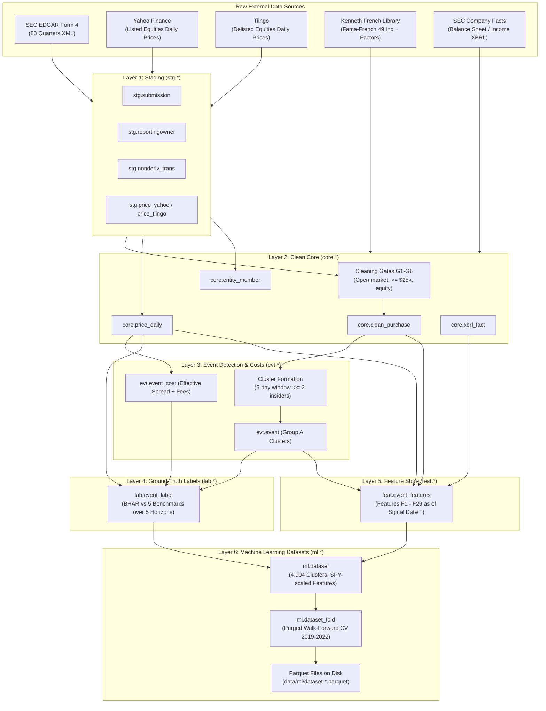

# EDGAR-SENTINEL: Data Provenance, Calculations & ML Architecture Guide

This document is the single source of truth for the data architecture, transformation pipeline, feature definitions, and machine learning setup in the **EDGAR-Sentinel** project. It is designed for both human researchers and autonomous AI coding agents (Claude, Cursor, Copilot, ChatGPT, Antigravity) to understand, verify, and build models on this dataset without ambiguity.

---

## 1. Executive Pipeline Architecture

The pipeline transforms raw, noisy regulatory SEC filings into a clean, leakage-free machine learning dataset through six distinct architectural layers:



---

## 2. Data Sources & Provenance

| Source | Description | Coverage | Key Tables in Warehouse |
|---|---|---|---|
| **SEC EDGAR Form 4** | Insider transaction filings (XML) submitted to the SEC by corporate insiders (officers, directors, 10% owners). | 83 quarters (2006 Q1 to 2026 Q3) | `stg.submission`, `stg.reportingowner`, `stg.nonderiv_trans`, `stg.footnotes` |
| **Yahoo Finance** | Daily OHLCV stock prices and splits for listed US equities, plus SPY and IWM benchmarks. | 2010 to 2026 | `stg.price_yahoo` $\rightarrow$ `core.price_daily` |
| **Tiingo API** | Survivorship-bias-free daily stock prices for companies that subsequently delisted or merged. | 2010 to 2026 | `stg.price_tiingo` $\rightarrow$ `core.price_daily` |
| **Kenneth French Library** | Daily Fama-French 3-factor, 5-factor, and 49 equal-weighted industry returns. | 2010 to 2026 | `core.ff_factor_daily`, `core.ff_industry_daily`, `core.sic_industry` |
| **SEC Company Facts** | As-reported XBRL financial statements (book equity, assets, liabilities, net income, cash). | Point-in-time up to signal date $T$ | `core.xbrl_fact` |

---

## 3. Data Cleaning & Transaction Gates (G1 to G7)

Raw Form 4 filings contain option exercises, gifts, inheritances, and small routine stock grants. To isolate pure, high-conviction economic signals, the pipeline applies **Gates G1 through G7** in `src/sentinel/gates/`:

- **Gate G1 (Open-Market Only)**: Transaction code must be `'P'` (open-market purchase). Sales (`'S'`) are tracked separately for historical context.
- **Gate G2 (Common Equity Only)**: The security title must be common stock or ordinary shares (excluding warrants, preferred stock, units, debt).
- **Gate G3 (Clean Trade Line)**: Valid positive share count, valid non-zero transaction price, clean non-derivative line.
- **Gate G4 (Economic Materiality)**: The purchase must be at least **$25,000 USD** within that filing.
- **Gate G5 (Insider Role Qualification)**: Excludes passive 10% owners who are purely institutional funds unless an individual officer/director is co-filing.
- **Gate G6 (Reporting Sanity)**: Shares held after the trade must be strictly positive (`shares_after > 0`).
- **Gate G7 (Operational Business Only)**: Excludes investment vehicles, shell entities, and SPACs without standard SIC industry codes (Decision D45).

Filings passing all gates are compiled into `core.clean_purchase` (161,059 high-conviction insider trades).

---

## 4. Insider Event Clustering (Group A)

Multiple insiders buying the same stock at the same time is a significantly stronger signal than a single isolated buyer.
- **Cluster Window**: 5 consecutive trading days (`cluster_window = 5`).
- **Group A (Primary Target)**: A cluster of $\ge 2$ distinct insider entities purchasing stock in the same company within 5 trading days.
- **Signal Date ($T$)**: The acceptance timestamp of the final filing that completes the cluster criteria.
- **Trading Session ($T_{\text{session}}$)**: The first market session where an investor could execute the trade (next morning's open if filed after market close).

---

## 5. Ground-Truth Target Label ($y$)

The primary machine learning objective is to predict whether an insider cluster generates positive abnormal returns after realistic trading friction.

### Mathematical Formulation
1. **Holding Period**: $H = 63$ trading sessions (~3 calendar months).
2. **Gross Return**:
   $$R_{\text{gross}} = \prod_{t=1}^{63} (1 + R_{\text{stock},t}) - \prod_{t=1}^{63} (1 + R_{\text{industry},t})$$
   where the benchmark is the **Fama-French 49 Equal-Weighted Industry Return** matching the company's SIC code.
3. **Transaction Costs**:
   $$\text{Cost} = 2 \times \left( \frac{\text{Effective Spread}}{2} + \text{Broker Commission} \right)$$
   Estimated via the transaction cost model (`evt.event_cost`) using market capitalization, 20-day dollar volume, and daily volatility.
4. **Net Return**:
   $$R_{\text{net}} = R_{\text{gross}} - \text{Cost}$$
5. **Binary Label ($y$)**:
   $$y = \begin{cases} 1 & \text{if } R_{\text{net}} > 0 \\ 0 & \text{if } R_{\text{net}} \le 0 \end{cases}$$

Baseline positive hit rate across the 4,904 clusters is **43.9%**.

---

## 6. The Feature Store ($F_1$ through $F_{29}$)

All 29 features in `feat.event_features` are calculated **strictly point-in-time** as of signal date $T$. No data from session $T+1$ or later is ever used.

In `ml.dataset`, continuous dollar figures are normalized by dividing by the S&P 500 ETF close (`SPY`) at date $T$ and applying a log transform $\ln(1 + x / \text{SPY}_T)$ to eliminate inflation across 2012–2022.

| Feature | ML Column | Category | Description & Formula | Transformation |
|---|---|---|---|---|
| **F1** | `x_f1` | Cluster Dynamics | Number of distinct buying entities in the cluster | Raw integer count ($\ge 2$) |
| **F2** | `x_f2` | Cluster Dynamics | Total dollar value of purchases in the cluster | $\ln(1 + \text{USD} / \text{SPY}_T)$ |
| **F3** | `x_f3` | Cluster Dynamics | Buyer concentration: $\frac{\max(\text{Value})}{\sum \text{Value}}$ | Continuous $[0.0, 1.0]$ |
| **F4** | `x_f4` | Insider Role | Number of buying entities who are CEO or CFO | Integer count |
| **F5** | `x_f5` | Insider Role | Number of buying entities who are Independent Directors | Integer count |
| **F6** | `x_f6` | Insider Role | Number of buying entities who are 10% Beneficial Owners | Integer count |
| **F7** | `x_f7` | Conviction | Average log increase in holdings: $\text{mean}(\ln(\frac{\text{Shares}_{\text{after}}}{\text{Shares}_{\text{before}}}))$ | Continuous |
| **F8** | `x_f8` | Conviction | Count of insiders opening a brand-new position ($\text{Shares}_{\text{before}} = 0$) | Integer count |
| **F9** | `x_f9` | Track Record | Opportunistic fraction (Cohen, Malloy & Pomorski 2012 classification) | Continuous $[0.0, 1.0]$ |
| **F10** | `x_f10` | Track Record | Empirical-Bayes shrunk historical hit rate of buyers at this issuer | Continuous $[0.0, 1.0]$ |
| **F11** | `x_f11` | Urgency | Filing lag: average calendar days between trade execution and Form 4 filing | Continuous days |
| **F12** | `x_f12` | Sentiment | Total dollar value of open-market sales by any insider in prior 90 days | $\ln(1 + \text{USD} / \text{SPY}_T)$ |
| **F13** | `x_f13` | Sentiment | Indicator if CEO or CFO sold stock in prior 90 days | Binary $\{0, 1\}$ |
| **F14** | `x_f14` | History | Number of clean purchase filings at this company in prior 2 years | Integer count |
| **F15** | `x_f15` | Proximity | Days elapsed since the company's last 10-Q or 10-K earnings filing | Continuous days |
| **F16** | `x_f16` | Size | Market capitalization as of session $T$ | $\ln(1 + \text{Cap} / \text{SPY}_T)$ |
| **F17** | `x_f17` | Liquidity | Average Daily Dollar Volume over prior 20 trading sessions ($\text{ADDV}_{20}$) | $\ln(1 + \text{ADDV} / \text{SPY}_T)$ |
| **F18** | `x_f18` | Impact | Purchase value relative to liquidity: $\frac{\text{Total Value}}{\text{ADDV}_{20}}$ | Continuous ratio |
| **F19** | `x_f19` | Momentum | 1-month short-term price momentum: $\frac{P_T}{P_{T-21}} - 1$ | Continuous return |
| **F20** | `x_f20` | Momentum | 12-to-1 month intermediate momentum: $\frac{P_{T-21}}{P_{T-252}} - 1$ | Continuous return |
| **F21** | `x_f21` | Momentum | 52-week high ratio: $\frac{P_T}{\max(P_{252})}$ | Continuous $(0.0, 1.0]$ |
| **F22** | `x_f22` | Risk | Annualized idiosyncratic return volatility (from cost model) | Continuous |
| **F23** | `x_f23` | Risk | Effective bid-ask spread | Continuous |
| **F24** | `x_f24` | Sector | Fama-French 12 Sector classification | Categorical string |
| **F25** | `x_f25` | Relative Size | Purchase value relative to market cap: $\frac{\text{Total Value}}{\text{Market Cap}}$ | Continuous ratio |
| **F26** | `x_f26` | Valuation | Book-to-Market ratio: $\frac{\text{Book Equity}}{\text{Market Cap}}$ (from point-in-time XBRL) | Continuous |
| **F27** | `x_f27` | Health | Net Loss Indicator ($\text{Net Income} < 0$ in most recent XBRL filing) | Binary $\{0, 1\}$ |
| **F28** | `x_f28` | Balance Sheet | Financial Leverage: $\frac{\text{Total Liabilities}}{\text{Total Assets}}$ (from point-in-time XBRL) | Continuous ratio |
| **F29** | `x_f29` | Balance Sheet | Cash Ratio: $\frac{\text{Cash \& Equivalents}}{\text{Total Assets}}$ (from point-in-time XBRL) | Continuous ratio |

---

## 7. Machine Learning Setup & Cross-Validation

The project implements **Purged Walk-Forward Cross-Validation** (Marcos López de Prado, *Advances in Financial Machine Learning*) to guarantee strict out-of-sample realism.

### The 4 Walk-Forward Folds
- **Fold 2019**: Trains on $\le 2018$; evaluated out-of-sample on all 2019 events (506 test events).
- **Fold 2020**: Trains on $\le 2019$; evaluated out-of-sample on all 2020 events (694 test events).
- **Fold 2021**: Trains on $\le 2020$; evaluated out-of-sample on all 2021 events (451 test events).
- **Fold 2022**: Trains on $\le 2021$; evaluated out-of-sample on all 2022 events (448 test events).

### Partition Roles (`part` column in `ml.dataset_fold`)
1. **`fit`**: Model training (tree splits, regression parameters).
2. **`tune`** (6 months before calibration): Hyperparameter selection.
3. **`calibrate`** (6 months before test year): Probability calibration (isotonic regression / Platt scaling).
4. **`test`** (Held-out year): Unbiased out-of-sample evaluation.
5. **`purged`** (Zero-weight anti-leakage shield): Events whose 63-day forward holding period extends across partition boundaries are completely discarded (`weight = 0.0`).

### Sample Uniqueness & Concurrency Weights (`weight`)
If 20 insider clusters occur during the same week in a market crash, their 63-day forward return windows heavily overlap in calendar time. To prevent macro shocks from dominating training loss, each event is weighted by its **Label Uniqueness**:
$$u_i = \frac{1}{63} \sum_{t=1}^{63} \frac{1}{c_t}$$
where $c_t$ is the number of active event windows running concurrently on session $t$. In `ml.dataset_fold`, weights are normalized so the average weight in the training set is exactly $1.0$.

---

## 8. Quickstart for Teammates & AI Coding Agents

### Option A: Working Directly with Parquet (No Database Required)
The final machine learning datasets are exported as versioned Parquet files under `data/ml/` (3.1 MB total):
- `data/ml/dataset-77b4ae549599.parquet`: The feature table (4,904 rows $\times$ 35 columns).
- `data/ml/dataset_fold-77b4ae549599.parquet`: The cross-validation fold masks (16,676 rows).

```python
import pandas as pd

# Load features and labels
df = pd.read_parquet("data/ml/dataset-77b4ae549599.parquet")

# Load fold assignments and sample weights
folds = pd.read_parquet("data/ml/dataset_fold-77b4ae549599.parquet")

# Example: Prepare Training Data for Fold 2022
f2022 = folds[folds["fold"] == 2022]
train_events = f2022[f2022["part"].isin(["fit", "tune", "calibrate"])]
test_events = f2022[f2022["part"] == "test"]

train_df = df.merge(train_events[["event_id", "part", "weight"]], on="event_id")
test_df = df.merge(test_events[["event_id", "part", "weight"]], on="event_id")

feature_cols = [c for c in df.columns if c.startswith("x_f") and c != "x_f24"]  # numeric features

X_train, y_train, w_train = train_df[feature_cols], train_df["y"], train_df["weight"]
X_test, y_test = test_df[feature_cols], test_df["y"]

print(f"Train samples: {len(X_train)}, Test samples: {len(X_test)}")
```

### Option B: Querying the DuckDB Warehouse via SQL
If you have `data/warehouse.duckdb` (6.7 GB):

```python
import duckdb

con = duckdb.connect("data/warehouse.duckdb", read_only=True)

# Query summary across all 4 walk-forward folds
summary = con.execute("SELECT * FROM ml.dataset_summary ORDER BY fold, part").df()
print(summary)
```

### Option C: Launching the Interactive Web UI
You can inspect tables, run ad-hoc queries, and explore events directly in your browser:

```bash
uv run sentinel explore --port 4213
```
Then open `http://localhost:4213` in your browser.
