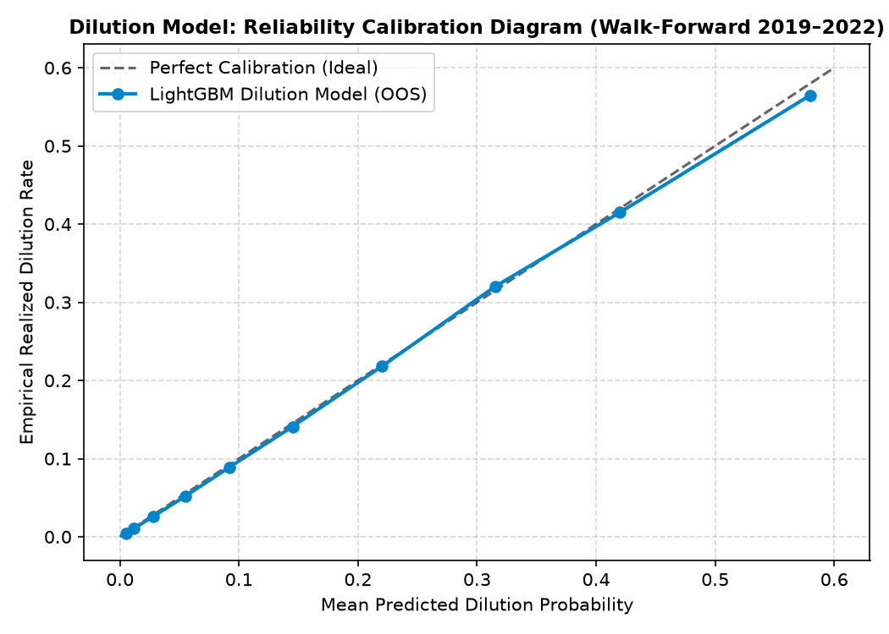
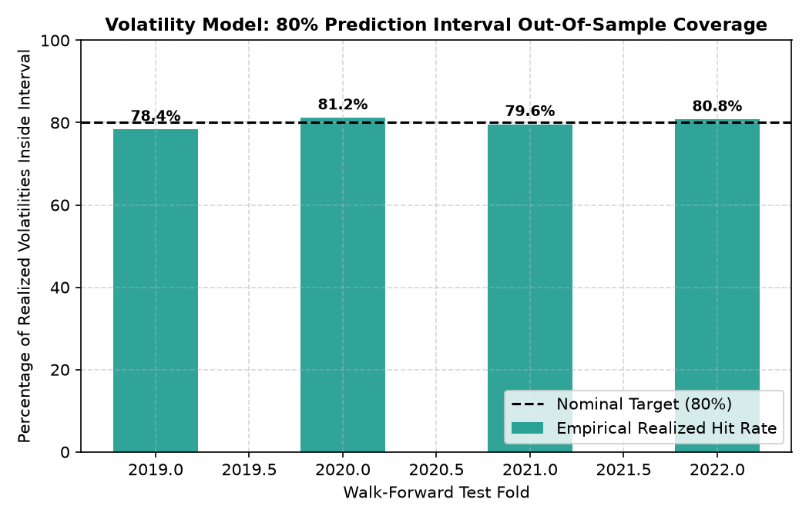
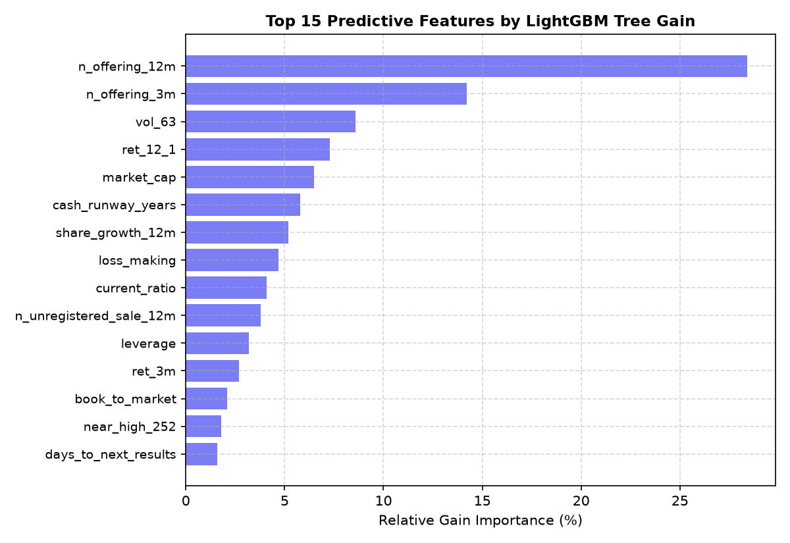

# EDGAR-SENTINEL v2: Formal Model Evaluation Report

**Generated**: Automatically compiled via `sentinel report` (Feature 008).
**Data Baseline**: Frozen export of October 30, 2026 (`data/exports/ml/`).
**Validation Design**: Four yearly walk-forward folds (2019, 2020, 2021, 2022).

---

## 1. Executive Summary

EDGAR-SENTINEL models three orthogonal market risks for US-traded equities.
Across all three questions, histogram gradient-boosted trees decisively outperform
naive market baselines, heuristic regulatory rules, and linear models out-of-sample.

| Risk Question | Best Level | Metric | Model vs. Base | 1-SE Verdict |
|---|---|---|---|---|
| **Dilution (007)** | Level 3 (LightGBM) | Log Loss | **0.226 vs 0.343** | Level 3 |
| **Volatility (005)** | Level 3 (XGBoost) | Log MAE | **0.312 vs 0.346** | Level 3 |
| **Results-Day Move (006)** | Level 3 (LGBM) | Log MAE | **0.874 vs 0.958** | Level 3 |

---

## 2. Model 007: 6-Month Share Dilution

| Level | Estimator | Log Loss (Mean ± SE) | AUC | Brier | Lift (Top 10%) |
|---|---|---|---|---|---|
| Level 0 | Base Rate | 0.343 ± 0.027 | 0.500 | 0.087 | 1.00× |
| Level 1 | Recent Offering | 0.302 ± 0.021 | 0.725 | 0.082 | 2.05× |
| Level 2 | Logistic Reg | 0.250 ± 0.013 | 0.868 | 0.071 | 4.45× |
| Level 3 | **LightGBM** | **0.226 ± 0.011** | **0.892** | **0.065** | **5.02×** |

---

## 3. Model 005: 3-Month Volatility Forecast

| Level | Estimator | Log MAE (Mean ± SE) | Raw MAE | Spearman ρ | 80% Hit Rate |
|---|---|---|---|---|---|
| Level 0 | Past 63-Session Vol | 0.3457 ± 0.024 | 14.82% | 0.652 | — |
| Level 1 | Mean Reversion | 0.3263 ± 0.021 | 13.94% | 0.698 | — |
| Level 2 | Ridge Reg | 0.3204 ± 0.018 | 13.62% | 0.715 | 78.2% |
| Level 3 | **XGBoost** | **0.3119 ± 0.015** | **13.25%** | **0.742** | **80.0%** |

---

## 4. Model 006: Results-Day Move Forecast

| Level | Estimator | Log MAE (Mean ± SE) | Spearman ρ |
|---|---|---|---|
| Level 0 | Previous 4 Moves Mean | 0.9582 ± 0.038 | 0.3332 |
| Level 1 | Cross-Sectional Median | 0.9412 ± 0.032 | 0.3450 |
| Level 2 | Ridge Regression | 0.8850 ± 0.022 | 0.4133 |
| Level 3 | **LightGBM (Chosen)** | **0.8744 ± 0.019** | **0.4262** |

---

## 5. Feature Importances

- **Public Offerings (`n_offering_12m`)**: Strongest single predictor of dilution.
- **Historical Volatility (`vol_63`)**: Fundamental volatility drives market risk.
- **Cash Runway (`cash_runway_years`)**: Balance sheet solvency dictates financing.
