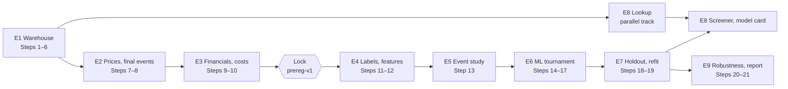

# 03 – Technical work breakdown

Effort is in the coding agent's working days (S = 1–2 days, M = 3–5, C = 6+, with the estimate in brackets). The researcher's time is listed separately. These estimates are conservative: Steps 2–5, estimated at about 5 days, took one day on 23 October. Downloads from external sources and the researcher's checkpoints cannot be compressed, though.

The project trains models and builds a data pipeline rather than prompting an LLM, so the course's areas are adapted: **Data** (sources, tables), **Model/analysis**, **Backend** (CLI commands, API), **Frontend** (product pages) and **QA** (tests, audits, run notes).

## Epics

| Epic | Data | Model / analysis | Backend | Frontend | QA | Effort | Main risks |
|---|---|---|---|---|---|---|---|
| **E1 Insider warehouse** (feature 002; Steps 1–6) | ✅ 83 SEC data sets staged; ✅ entities, gates, events. To do: symbol map; about 27,300 filing headers (SIC, acceptance time) | ✅ Preliminary events A, B1, B2 | ✅ `stage`, `entities`, `gates`, `detect-prelim`, `explore`. To do: `symbols`, `fetch-headers`, `build` | — | ✅ 172 tests, W1–W9. To do: real-data truncation test, full rebuild timing, D45 check | S (2 d remaining) | Slow SEC responses (R11); wrong ticker matches (R3) |
| **E2 Prices, final events, delistings** (Steps 7–8) | Yahoo for listed stocks, SPY and IWM, with as-traded prices rebuilt from splits; Tiingo for delisted stocks (stored only during the paid month); French library; FINRA tick-size lists | G8 price check, G7 issuer types (with D45), tradability floors, cooldown; final events; delisting classes and returns | `fetch-prices`, `fetch-reference`, `detect`, `delistings` | — | Price tests, coverage ≥ 90%, G8 ≥ 95%, golden set of 30, delisting audit of 30 | M (4.5 d) | yfinance breaks or throttles (R4); the Tiingo month runs out (R2); ticker reuse (R3) |
| **E3 Company financials and costs** (Steps 9–10) | XBRL company facts: shares outstanding and five items, first-filed values only | Spread estimates (Abdi–Ranaldo) and the cost model (§6.8) | `shares-out`, `costs` | — | Market caps match known examples; coverage per item; cost-by-price-bucket plot | S (1.5 d) | Missing XBRL tags for small filers |
| **Lock** (Step 10a) | — | — | — | — | Decision log D45–D47; Appendix E matches `params.yaml`; tag `prereg-v1` | S (0.5 d) | Late reviewer feedback |
| **E4 Labels and features** (Steps 11–12) | Labels for 5 horizons × 4 benchmarks, gross and net, windows ending by 31 Dec 2022; features F1–F29 as of T | Delisting returns in labels; F10 from development windows only | `labels`, `features` | — | Point-in-time tests; 10 labels recomputed by hand; missing-value report | S (2.5 d) | Look-ahead leaks (caught by the truncation tests) |
| **E5 Event study** (Step 13) | — | H1–H3: BHAR tables, return paths, calendar-time alphas; **median and share positive beside every mean, results by year** (research row 10) | `event-study` | Figures for the report | Results frozen before any ML result | S (1 d) | Results driven by a crisis year (R6) |
| **E6 ML tournament** (Steps 14–17) | Versioned ML dataset, folds, purging, weights | 6 baselines, 3 model families (24 settings) plus an ensemble; calibration; SHAP | `ml-dataset`, `baselines`, `tournament`, `explain` | — | Leakage tests; MLflow runs; one-standard-error selection | M (3 d) | Overfitting through repeated tries (R7) |
| **E7 Holdout and production model** (Steps 18–19) | `hold` schema written by one guarded job | H4, H5 and replications of H1–H3, once; production refit; latest scores | `holdout`, `score-live` | — | Guard log shows a single run | S (1 d) | Temptation to re-run (prevented by the guard) |
| **E8 Product v1** (Steps P, 19) | Read-only views on the warehouse | Bands and holdout hit rates (D47); fact lines; drivers in words | FastAPI endpoints (plan §8.6) | Lookup, screener, model card, glossary (P1–P3, P5–P8) | Endpoint tests; one test per presentation rule | M (4 d) | Scores misread as a profit chance (user research); licensing (R10) |
| **E9 Robustness and delivery** (Steps 20–21) | Offline rebuild from the raw snapshot | Appendix E sensitivity variants on the development period | `robustness`, `report` | Report figures | Rebuild check before the Tiingo month ends; deletion logged | S (2 d) | Schedule overrun (R9) |

**Musts in total: about 22 agent-days.** Should items: daily EDGAR ingestion (2 d), B2 extras (0.5 d), SHAP drivers in words (0.5 d).

**The researcher's time:** audit sheets (about 2 h, by 27 Oct), D45 check (45 min), golden set and delisting audits (about 3.5 h), 10 hand-computed labels (1 h), approvals at each checkpoint, and writing the report (2–3 days in week 4).

## Dependencies

Hard constraints:
- **No return is computed before the lock** (constitution; plan §3.3). Labels (E4) wait for `prereg-v1`.
- **The event study is written before any ML result exists.**
- **The holdout runs once**, triggered by the researcher.
- **Tiingo data is used only during the paid month** (about 29 Oct – 28 Nov), so the offline rebuild check (E9) must run before it ends.

## Risks

The plan's register (§10) applies unchanged. The user research adds one:

| Risk | Likelihood / impact | Mitigation |
|---|---|---|
| Users read a model score as a promised profit, especially if the model is weak | High / High for the product | Bands with hit rates, a caveat beside every score, "no proven skill" if H4 fails (D47), each enforced by a test |
| Week 2 overruns: four data sources in five days | Medium / High | Design E2 during week 1 (task 1.9); start Yahoo on 29 Oct before Tiingo; the pre-registered cut order applies if week 2 slips by more than two days |
