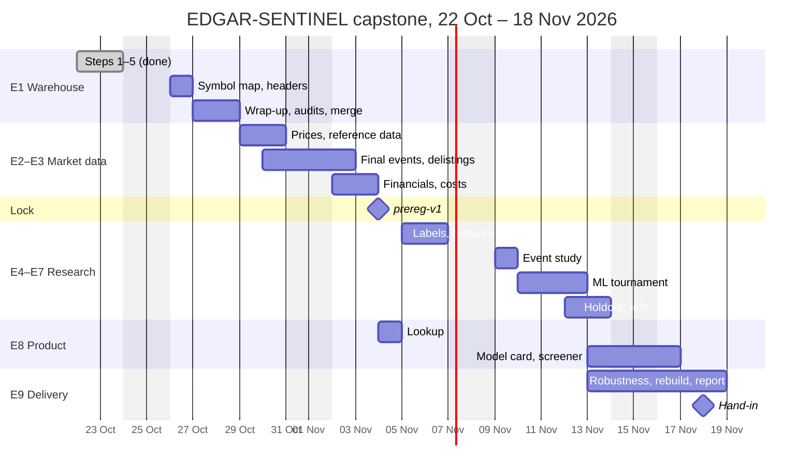

# 05 – User stories and tasks

**Owners:** R = the researcher, C = the coding agent (Claude Code). **Dates** are working days, Monday to Friday. The weekends of 24–25 Oct, 31 Oct – 1 Nov, 7–8 Nov and 14–15 Nov are buffer, worked when the schedule needs them ([04](04-effort-prioritization.md)). Each epic is built as a spec-kit feature, numbered by spec-kit in creation order. Tasks marked ✅ are done.

## Outcome goals

From [01](01-outcome-goals.md):
- **Research.** By 18 Nov, a pre-registered, cost-adjusted answer to H1–H5, with delisted stocks included and the holdout evaluated once.
- **Product.** By 18 Nov, a retail investor can look up any stock's insider trades and sees the latest clusters' scores as bands with a hit rate, a caveat and a plain reason; every presentation rule is tested (D47).
- **Learning.** Point-in-time data and leakage-free ML, end to end.

---

## E1 – Insider warehouse (Steps 1–6; feature 002)

**User stories**
- **US-1.1.** *As the researcher, I want every insider filing in typed tables, so that every later step reads one verified source.*
  Acceptance: 37,937,561 rows and 0 mismatches; a rebuild gives identical tables. ✅
- **US-1.2.** *As the reviewer, I want owners who file together merged into one insider, using only filings up to the signal date, so that a fund and its manager don't count as a cluster.*
  Acceptance: truncation tests pass; at least 90% agreement on the 50-entity audit.
- **US-1.3.** *As the researcher, I want genuine open-market purchases separated from plan trades, offerings and token buys, with every exclusion counted, so that events rest on real decisions.*
  Acceptance: the funnel reconciles in every quarter; at least 90% agreement on both gate audits.
- **US-1.4.** *As the researcher, I want every event company mapped to a price symbol and every signal filing's industry code, so that I know exactly what to price and which issuers G7 removes.*
  Acceptance: at least 95% of event companies mapped; at least 99% of headers parsed; events with no SIC code counted per year and group (D45).

**Deliverables:** `stg`, `core`, `evt` and `audit` tables; three audit sheets plus the D45 sheet; symbol map; filing headers; run notes; `main` updated.

| # | Task | Component | Done when | Depends on | Who | Day |
|---|---|---|---|---|---|---|
| 1.1 | Staging, committing quarter by quarter | `core/stage.py`, `sentinel stage` | 0 mismatches | — | C | ✅ 23 Oct |
| 1.2 | Point-in-time entities and roles | `core/entities.py` | W7, W8, truncation pass | 1.1 | C | ✅ 23 Oct |
| 1.3 | Gates G1–G6, clean purchases, holdings, funnel | `core/gates.py` | Funnel reconciles; W5, W6 | 1.2 | C | ✅ 23 Oct |
| 1.4 | Preliminary events A, B1, B2; comparison with feature 001 | `events/prelim.py`, `compare.py` | SC-005 holds; no year flagged | 1.3 | C | ✅ 23 Oct |
| 1.6 | Symbol map for all three groups; Tiingo coverage counted in memory only | `core/symbols.py`, `sentinel symbols` | At least 95% mapped (98.1%); W10, W11 | 1.4 | C | ✅ 23 Oct |
| 1.7 | Fetch about 27,300 signal-filing headers in the background (a few hours); parse SIC and acceptance time; D45 report and a 30-row no-SIC sheet (`audit no-sic`) | `ingest/sec_headers.py`, `fetch-headers` | At least 99% parsed; no-SIC events counted per year and group | 1.4 | C | ✅ 24 Oct (27,288 of 27,290; D45 sheet written) |
| 1.8 | Fill the three audit sheets (about 2 h) | `specs/002-…/audits/` | No blank verdicts | ✅ sheets | R | Tue 27 Oct |
| 1.9 | Invariant check, real-data truncation test (20 pairs), full rebuild timing, docs | `warehouse.py`, `tests/integration/` | All pass (rebuild 6 min; 20/20 pairs); timings in the run notes | 1.6 | C | ✅ 23 Oct |
| 1.10 | Audit summary; fix or document each error pattern | `sentinel audit summary`, run notes | At least 90% per sheet, or fixes recorded | 1.8 | C | Tue 27 Oct |
| 1.11 | Merge features 001–003 into `main`; delete the feature branches | git | Tests green on `main` | — | R, C | ✅ 23 Oct |
| 1.12 | Specify, plan and break down E2 + E3 (one spec-kit feature) | `specs/…` | Tasks reviewed by R | 1.11 | C, R | ✅ 23 Oct (feature 004) |
| 1.13 | Fill the D45 sheet: 30 no-SIC events, fund or operating company (45 min) | Audit sheet | Verdicts recorded | 1.7 | R | Thu 29 Oct |

---

## E2 – Prices, final events and delistings (Steps 7–8)

**User stories**
- **US-2.1.** *As the researcher, I want prices for listed and delisted companies, so that companies that failed or were acquired stay in the sample.*
  Acceptance: price coverage of A and B1 events at least 90%, reported by year and delisting status; Tiingo files stored only during the paid month, each tagged for deletion.
- **US-2.2.** *As the reviewer, I want the final events to apply G7, G8, the tradability floors and the cooldown using only prices known on the day, so that every event could really have been traded.*
  Acceptance: G8 passes for at least 95% of mapped clean purchases; golden set of 30 events matches EDGAR, or each difference is explained.
- **US-2.3.** *As the researcher, I want every price series that ends early classified as acquired, performance-related or unknown, so that delisting returns rest on evidence.*
  Acceptance: 30 companies across the three classes checked by hand.

**Deliverables:** `core.price_daily`, reference tables (factors, industries, breakpoints, FINRA lists), `evt.event`, `core.delisting`, coverage report.

| # | Task | Component | Done when | Depends on | Who | Day |
|---|---|---|---|---|---|---|
| 2.1 | Subscribe to Tiingo Power with auto-renewal off; log the start date | Tiingo account, decision log | Logged | 1.6 | R | ✅ 26 Oct |
| 2.2 | Yahoo fetcher: listed stocks, SPY, IWM, split histories; as-traded prices rebuilt; responses cached; run in the background | `ingest/yahoo.py`, `fetch-prices` | Price tests pass; listed coverage reported | 1.12 | C | ✅ 24 Oct (97.5% of listed) |
| 2.3 | Tiingo fetcher for delisted final tickers (including `Q` tickers); every file tagged for deletion | `ingest/tiingo.py` | Delisted coverage reported | 2.1, 1.6 | C | ✅ 26 Oct |
| 2.4 | French data library (factors, 49 industries, SIC definitions, breakpoints) and FINRA tick-size lists | `fetch-reference` | Tables load; dates cover 2006–Aug 2026 | 1.12 | C | ✅ 23 Oct |
| 2.5 | G8, G7 (SIC at filing, with D45 and its fallback), floors and cooldown → final events; coverage report by year and delisting status | `events/`, `sentinel detect` | G8 ≥ 95%; coverage ≥ 90% | 2.2–2.4, 1.13 | C | Listed ✅ 24 Oct (G8 93.8%); again after 2.3, Fri 30 Oct |
| 2.6 | Golden set: 30 events checked against EDGAR (about 2 h) | Audit sheet | 30 of 30, or explained | 2.5 | R | Mon 2 Nov |
| 2.7 | Delisting classification and delisting returns | `core/delisting.py`, `sentinel delistings` | Every early-ending series classified | 2.5 | C | ✅ 26 Oct |
| 2.8 | Delisting audit: 30 companies across the three classes (about 1.5 h) | Audit sheet | Verdicts recorded | 2.7 | R | Tue 3 Nov |

---

## E3 – Company financials and costs (Steps 9–10)

**User stories**
- **US-3.1.** *As the researcher, I want shares outstanding and five balance-sheet items as first filed, so that features use only what the market knew at T.*
  Acceptance: market caps and book values match known examples; coverage reported per item.
- **US-3.2.** *As the researcher, I want each event's estimated round-trip cost, so that every headline number is net of what the trade would have cost.*
  Acceptance: the cost-by-price-bucket plot is plausible; costs follow plan §6.8.

| # | Task | Component | Done when | Depends on | Who | Day |
|---|---|---|---|---|---|---|
| 3.1 | XBRL company facts: fetch, keep first-filed values only, load | `ingest/`, `core.xbrl_fact`, `shares-out` | Examples match; coverage per item | 1.6 | C | ✅ 24 Oct (8 of 10, misses explained) |
| 3.2 | Spread estimates (Abdi–Ranaldo) and the cost model | `core/costs.py`, `sentinel costs` | Plot in the run notes | 2.5 | C | ✅ 24 Oct (table; no jump except at $2) |

---

## Pre-registration lock (Step 10a)

| # | Task | Component | Done when | Depends on | Who | Day |
|---|---|---|---|---|---|---|
| L.1 | Decision log: add the D45 check's result (D45 and D47 are logged); check Appendix E against `params.yaml`; prepare the tag | `docs/initialplan.md` §12, `sentinel check` | `check` passes | 1.13, 2.5 | C | Tue 3 Nov |
| L.2 | Approve the decision entries (D45 with its check result, D46–D52) | — | Approved | L.1 | R | Tue 3 Nov |
| L.3 | Tag `prereg-v1`, push it, publish it as a GitHub Release (D48) | git, GitHub | Tag and release on GitHub | L.2 | R | Wed 4 Nov |

---

## E4 – Labels and features (Steps 11–12)

**User stories**
- **US-4.1.** *As the researcher, I want labels for every event, horizon and benchmark, gross and net of cost, with delistings handled and only windows ending by 31 December 2022, so that the development data never touch the holdout.*
  Acceptance: point-in-time tests pass; 10 labels recomputed by hand.
- **US-4.2.** *As the researcher, I want features F1–F29 computed as of T, so that the model sees only what was public.*
  Acceptance: point-in-time tests pass; missing-value report.

| # | Task | Component | Done when | Depends on | Who | Day |
|---|---|---|---|---|---|---|
| 4.1 | Development labels: 5 horizons × 4 measures, gross and net, delisting returns | `labels/`, `sentinel labels` | Point-in-time tests pass | L.3, 2.7, 3.2 | C | Thu 5 Nov |
| 4.2 | Recompute 10 labels by hand (about 1 h) | Spreadsheet | 10 of 10 match | 4.1 | R | Thu 5 Nov |
| 4.3 | Insider and timing features F1–F15 | `features/` | Point-in-time tests pass | 4.1 | C | Fri 6 Nov |
| 4.4 | Market and company features F16–F29; missing-value report | `features/`, `sentinel features` | Point-in-time tests pass | 3.1, 4.3 | C | Fri 6 Nov |

---

## E5 – Event study (Step 13)

**User story**
- **US-5.1.** *As the reviewer, I want H1–H3 tested on 2012–2022 with the pre-registered statistics, plus the median, the share of positive events and results by year beside each mean, written before any ML result exists, so that the answer can't be shaped by the model.*
  Acceptance: the write-up is committed before the ML dataset exists.

| # | Task | Component | Done when | Depends on | Who | Day |
|---|---|---|---|---|---|---|
| 5.1 | Event study: BHAR tables, return paths, calendar-time alphas, medians, hit rates, by year; B2 if not cut | `study/`, `sentinel event-study` | Tables and figures in `reports/` | 4.4 | C | Mon 9 Nov |
| 5.2 | Read and approve the event-study write-up | Report draft | Approved; frozen | 5.1 | R | Mon 9 Nov |

---

## E6 – ML tournament (Steps 14–17)

**User story**
- **US-6.1.** *As the reviewer, I want the models trained with purged walk-forward folds and compared with six baselines, including a market-only model, so that any skill they show is real.*
  Acceptance: leakage tests pass; every run logged in MLflow; selection follows the one-standard-error rule.

| # | Task | Component | Done when | Depends on | Who | Day |
|---|---|---|---|---|---|---|
| 6.1 | ML dataset: folds, three-way splits, purging, weights; post-floor counts per fold | `ml/`, `sentinel ml-dataset` | Leakage tests pass; fold-size rule applied | 5.2 | C | Tue 10 Nov |
| 6.2 | Fit and score the six baselines | `sentinel baselines` | Logged in MLflow | 6.1 | C | Tue 10 Nov |
| 6.3 | Tournament (24 settings and the ensemble) with tuning and calibration slices; selection | `sentinel tournament` | Out-of-fold metrics; model selected | 6.2 | C | Wed 11 Nov |
| 6.4 | Approve the model selection | — | Approved | 6.3 | R | Wed 11 Nov |
| 6.5 | SHAP explanations and error analysis | `sentinel explain` | Figures; no implausible drivers | 6.3 | C | Thu 12 Nov |

---

## E7 – Holdout and production model (Steps 18–19, model part)

**User story**
- **US-7.1.** *As the reviewer, I want the holdout evaluated exactly once by a guarded job, so that the out-of-sample result can't be tuned.*
  Acceptance: the guard log shows a single run; H4, H5 and the H1–H3 replications reported.

| # | Task | Component | Done when | Depends on | Who | Day |
|---|---|---|---|---|---|---|
| 7.1 | Guarded holdout job, with tests that it refuses a second run | `labels/` (hold), `sentinel holdout` | Tests pass | 6.4 | C | Thu 12 Nov |
| 7.2 | Trigger the single holdout run | `sentinel holdout` | Guard log written | 7.1 | R | Thu 12 Nov |
| 7.3 | Refit the production model; score the latest clusters; band table with holdout hit rates (D47) | `sentinel score-live` | Scores and bands in `ml.prediction` | 7.2 | C | Fri 13 Nov |

---

## E8 – Product v1 (Steps P, 19; requirements P1–P8 in [06](06-user-research-response.md))

**User stories**
- **US-8.1.** *As a long-term investor, I want to look up any stock and see every insider trade in plain English, so that I don't have to dig through EDGAR.*
  Acceptance: search by ticker or name; every transaction with its code explained; holdings over time; links to the filings.
- **US-8.2.** *As a retail investor, I want each cluster's score as a band with its track record and a plain reason, so that I don't mistake it for a promised profit.*
  Acceptance: no raw probability in lists; a caveat beside every score; a fact line on every event; each rule covered by a test.
- **US-8.3.** *As a retail investor, I want to see how big, liquid and fresh each event is, so that I can skip events I can't or shouldn't trade.*
  Acceptance: market-cap band, daily dollar volume, industry, filing date, days since filing and sessions left on every row; a liquidity filter.
- **US-8.4.** *As any visitor, I want a model card and a glossary in plain English, so that I can judge the evidence without knowing the jargon.*
  Acceptance: the glossary covers the terms in [06](06-user-research-response.md) (row 6); the model card shows holdout results, calibration per band, limitations and a not-investment-advice notice; "no proven skill" is shown if H4 failed.

| # | Task | Component | Done when | Depends on | Who | Day |
|---|---|---|---|---|---|---|
| 8.1 | Stock lookup: API endpoints and page | `api/` | Endpoint tests pass | 1.11 | C | ✅ 24 Oct (feature 005) |
| 8.2 | Model card and glossary pages (P7) | `api/`, templates | Pages render with the holdout results; all terms covered | 6.3, 7.2 | C | Fri 13 Nov |
| 8.3 | Screener and event page: bands, caveat, fact line, size, liquidity, freshness, filters, H4 rule (P1–P3, P5, P6, P8); drivers in words if not cut (P4) | `api/`, templates | Endpoint tests pass, plus one test per presentation rule | 7.3 | C | Mon 16 Nov |
| 8.3b | Horizon scores: the multi-horizon model's probability per horizon (21, 63, 126, 252 sessions) beside the holdout hit rate and median net return of past events in the band, and which horizon has been best (D54) | `api/`, templates | Endpoint tests pass | 6.3, 7.3 | C | Mon 16 Nov |
| 8.4 | Plain-English explanation of each flagged cluster by a language model from a fixed fact sheet, validated, stored, with a template fallback (D55) | `api/`, `ml.explanation` | Validator tests pass; no number outside the fact sheet | 8.3, 7.3 | C | Tue 17 Nov |

---

## E9 – Robustness and delivery (Steps 20–21)

**User story**
- **US-9.1.** *As the reviewer, I want the sensitivity variants, an offline rebuild and the report, so that I can judge how fragile the results are and reproduce them.*
  Acceptance: every Appendix E variant run once on the development period; a clean clone plus the raw snapshot rebuilds the key tables offline; the report is handed in.

| # | Task | Component | Done when | Depends on | Who | Day |
|---|---|---|---|---|---|---|
| 9.1 | Sensitivity variants, run unattended | `sentinel robustness` | Tables in `reports/` | 6.3 | C | Fri 13 Nov (runs over the weekend) |
| 9.2 | Offline rebuild check from a clean clone, before the Tiingo month ends | `sentinel build` | Key tables identical | 7.3 | C | Tue 17 Nov |
| 9.3 | Report figures and tables; demo script | `sentinel report` | Generated from the warehouse | 5.1, 7.2, 9.1 | C | Tue 17 Nov |
| 9.4 | Write the report (data and methods sections can be drafted in week 3); rehearse | Report | Submitted | 9.3 | R | Mon 16 – Wed 18 Nov |
| 9.5 | Delete all Tiingo data when the paid month ends; log it | Script, decision log | Deletion logged | 9.2 | R (C prepares) | about 28 Nov |

---

## Researcher-only actions

The agent prepares these but never does them unless told to.

| When | Action |
|---|---|
| Tue 27 Oct | Fill the three audit sheets (1.8) |
| Wed 28 Oct | Approve the merge to `main` and the E2 + E3 tasks (1.11, 1.12) |
| Thu 29 Oct | Subscribe to Tiingo Power, auto-renewal off (2.1); fill the D45 sheet (1.13) |
| Mon 2 – Tue 3 Nov | Golden-set and delisting audits (2.6, 2.8); approve the decision entries (L.2) |
| Wed 4 Nov | Tag `prereg-v1`, push it, publish the GitHub Release (L.3) |
| Thu 5 Nov | Recompute 10 labels by hand (4.2) |
| Mon 9 Nov | Approve the event-study write-up (5.2) |
| Wed 11 Nov | Approve the model selection (6.4) |
| Thu 12 Nov | Trigger the single holdout run (7.2) |
| Mon 16 – Wed 18 Nov | Report and hand-in (9.4) |
| About 28 Nov | Delete the Tiingo data (9.5) |

## Timeline

