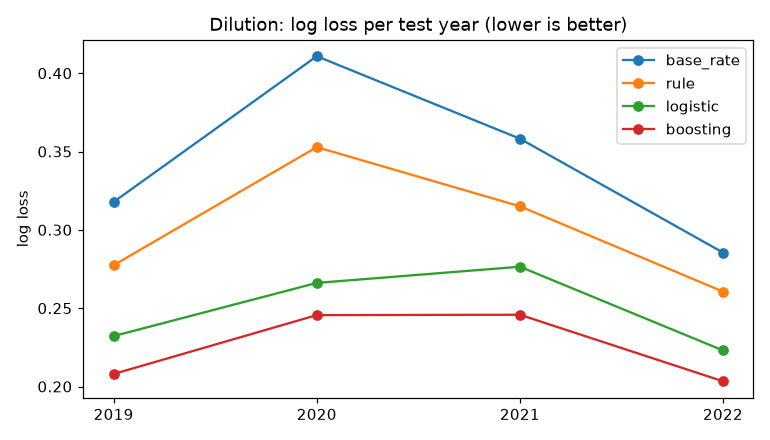
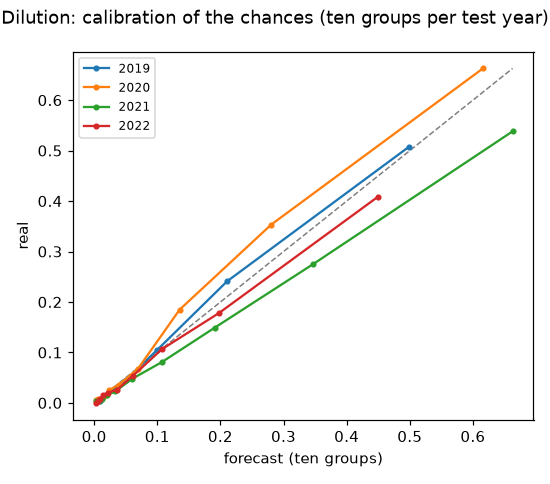
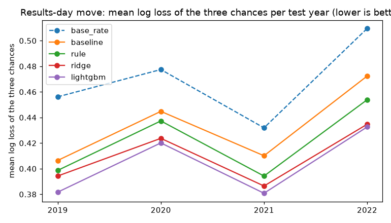
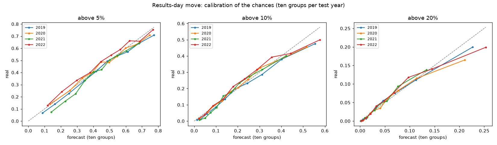
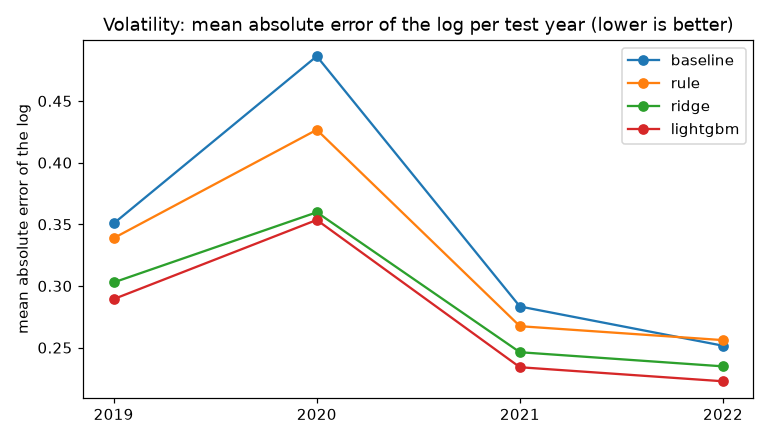
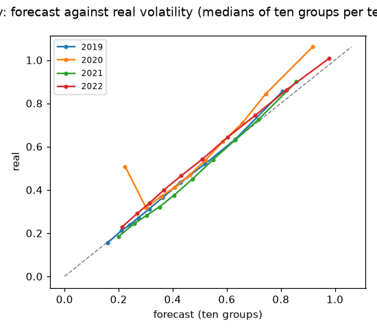

# EDGAR-SENTINEL · Model report

*Generated by `sentinel report` (feature 008) from the records the approved model notebooks wrote in MLflow; never edited by hand. Regenerate it with the commands of `specs/008-model-report/quickstart.md`. Every number below is an aggregate over many companies.*

## Summary

| question | chosen | deciding measure (lower is better) | chosen, mean of the test years | simplest level | simplest, mean | approved | holdout |
|---|---|---|---|---|---|---|---|
| Dilution (007) | boosting | log loss | 0.2257 | base_rate | 0.3431 | V2-52 | not run yet |
| Results-day move (006) | lightgbm | mean log loss of the three chances | 0.4038 | baseline | 0.4334 | V2-55 | not run yet |
| Volatility (005) | lightgbm | mean absolute error of the log | 0.2749 | baseline | 0.3430 | V2-58 | not run yet |

## 1. Dilution (007)

*Record: experiment `007-dilution`, run `4d830f6ac9524df69c0e7fb38f219cc2`, commit `d135609`, export of 2026-11-11, data hash `2d56ff1396d7`; from `notebooks/007-dilution-model.ipynb`. Approved: V2-52.*

**The question.** Will this company's share count rise sharply within the next six months, new shares diluting its shareholders?

**The answer, as pre-registered** (`config/risk_params.yaml`, labels):

- `window_days`: 182
- `min_increase`: 0.1

### The data

- rows: 420,648
- companies: 6,375
- first row: 2012-01-31
- last row: 2022-06-30
- base rate: 0.0962

### The method

Four levels, simplest first: `base_rate`, `rule`, `logistic`, `boosting`. Each learns only from rows whose answers were known before the year it is judged on (walk-forward test years, purged; every fitted step a `Dated`, V2-49); settings, calibration and band edges come from the year before; the simplest level within one standard error of the yearly gaps to the best is chosen (V2-50).

Rows per test year:

| year | inner | gap | valid | purged | test | train |
|---|---|---|---|---|---|---|
| 2019 | 210,211 | 20,307 | 20,498 | 20,330 | 40,243 | 251,016 |
| 2020 | 251,016 | 20,330 | 20,247 | 19,996 | 40,824 | 291,593 |
| 2021 | 291,593 | 19,996 | 20,031 | 20,793 | 45,246 | 331,620 |
| 2022 | 331,620 | 20,793 | 22,220 | 23,026 | 22,989 | 374,633 |

### The decisions that shaped the model

- V2-35: level 3 is LightGBM, as D60 names it.
- V2-36: the trees leave out the insider and macro families (decided after the first version's family check, so after seeing the test years; section 9b checks them again).
- V2-37: the levels are chosen by log loss.
- V2-39, V2-40: the split-like 'yes' answers (a stock split read as dilution) are dropped, found by code.
- V2-49: every fitted step is a Dated; V2-50: the year-by-year one-standard-error rule.
- V2-52: LightGBM approved by the researcher (5 Nov).

### Results: log loss (deciding; lower is better)

| level | 2019 | 2020 | 2021 | 2022 | mean |
|---|---|---|---|---|---|
| base_rate | 0.3178 | 0.4108 | 0.3582 | 0.2855 | 0.3431 |
| rule | 0.2774 | 0.3528 | 0.3150 | 0.2606 | 0.3015 |
| logistic | 0.2322 | 0.2661 | 0.2765 | 0.2230 | 0.2495 |
| boosting | 0.2080 | 0.2456 | 0.2458 | 0.2033 | 0.2257 |

**auc**

| level | 2019 | 2020 | 2021 | 2022 | mean |
|---|---|---|---|---|---|
| base_rate | 0.5000 | 0.5000 | 0.5000 | 0.5000 | 0.5000 |
| rule | 0.7343 | 0.7398 | 0.7187 | 0.7082 | 0.7253 |
| logistic | 0.8694 | 0.8891 | 0.8629 | 0.8460 | 0.8669 |
| boosting | 0.8963 | 0.9052 | 0.8847 | 0.8727 | 0.8897 |

**brier**

| level | 2019 | 2020 | 2021 | 2022 | mean |
|---|---|---|---|---|---|
| base_rate | 0.0873 | 0.1201 | 0.1017 | 0.0757 | 0.0962 |
| rule | 0.0798 | 0.1074 | 0.0933 | 0.0724 | 0.0882 |
| logistic | 0.0677 | 0.0801 | 0.0827 | 0.0639 | 0.0736 |
| boosting | 0.0618 | 0.0747 | 0.0744 | 0.0589 | 0.0675 |

**lift_top10**

| level | 2019 | 2020 | 2021 | 2022 | mean |
|---|---|---|---|---|---|
| base_rate | 0.5845 | 0.5905 | 0.6499 | 0.5346 | 0.5899 |
| rule | 2.2504 | 2.1215 | 1.8084 | 2.0855 | 2.0665 |
| logistic | 4.8691 | 4.6307 | 4.3634 | 4.2186 | 4.5204 |
| boosting | 5.2553 | 4.8569 | 4.7096 | 4.9755 | 4.9493 |

### The choice

| level | mean log loss | gap to the best (mean) | SE of the yearly gaps | years the best is better | as good as the best |
|---|---|---|---|---|---|
| base_rate | 0.3431 | 0.1174 | 0.0174 | 4 | no |
| rule | 0.3015 | 0.0758 | 0.0109 | 4 | no |
| logistic | 0.2495 | 0.0238 | 0.0025 | 4 | no |
| boosting | 0.2257 | 0.0000 | 0.0000 | 0 | yes |

Chosen: **`boosting`** (V2-50). For reference, the textbook rule (one standard error of the best level's own yearly scores) would choose `boosting`.

### Calibration of the chances (ten groups per test year)

### The bands

| band | rows | forecast | real_rate | year |
|---|---|---|---|---|
| 1 | 10,373 | 0.0061 | 0.0047 | 2019 |
| 2 | 7,918 | 0.0138 | 0.0110 | 2019 |
| 3 | 7,664 | 0.0303 | 0.0245 | 2019 |
| 4 | 7,377 | 0.0950 | 0.1036 | 2019 |
| 5 | 6,911 | 0.3871 | 0.4046 | 2019 |
| 1 | 5,277 | 0.0041 | 0.0063 | 2020 |
| 2 | 7,109 | 0.0092 | 0.0076 | 2020 |
| 3 | 8,797 | 0.0210 | 0.0202 | 2020 |
| 4 | 9,620 | 0.0698 | 0.0755 | 2020 |
| 5 | 10,021 | 0.3952 | 0.4571 | 2020 |
| 1 | 8,192 | 0.0050 | 0.0035 | 2021 |
| 2 | 7,349 | 0.0128 | 0.0087 | 2021 |
| 3 | 8,463 | 0.0323 | 0.0240 | 2021 |
| 4 | 10,802 | 0.1138 | 0.0865 | 2021 |
| 5 | 10,440 | 0.4681 | 0.3775 | 2021 |
| 1 | 5,620 | 0.0054 | 0.0034 | 2022 |
| 2 | 5,067 | 0.0151 | 0.0140 | 2022 |
| 3 | 4,866 | 0.0421 | 0.0335 | 2022 |
| 4 | 4,667 | 0.1336 | 0.1251 | 2022 |
| 5 | 2,769 | 0.4165 | 0.3803 | 2022 |

Over the test years (counts summed, shares weighted by rows; medians per year only):

| band | rows | forecast | real_rate |
|---|---|---|---|
| 1 | 29,462 | 0.0053 | 0.0044 |
| 2 | 27,443 | 0.0126 | 0.0101 |
| 3 | 29,790 | 0.0301 | 0.0246 |
| 4 | 32,466 | 0.0993 | 0.0927 |
| 5 | 30,141 | 0.4206 | 0.4104 |

### The hypotheses (`docs/hypotheses.md`)

| hypothesis | expected | change without (mean ± SE) | expected sign in years | verdict |
|---|---|---|---|---|
| H-D1 offerings (filing events) | n_offering_12m + | +0.0222 ± 0.0012 | 4 of 4 | supported |
| H-D2 need (runway, losses, cash, R&D, stock pay) | loss_making + | +0.0024 ± 0.0004 | 4 of 4 | supported |
| H-D3 habit (share growth, issue proceeds) | share_growth_12m + | +0.0019 ± 0.0002 | 4 of 4 | supported |
| H-D4 size and price | log_market_cap − | +0.0127 ± 0.0024 | 4 of 4 | supported |
| H-D5 insider, short volume, macro | no effect | insider -0.0002 ± 0.0006; macro -0.0021 ± 0.0015; short volume +0.0009 ± 0.0001 | – | not supported |

Family checks (change in the deciding measure without the family, per test year):

| check | features | 2019 | 2020 | 2021 | 2022 | mean | se | adds |
|---|---|---|---|---|---|---|---|---|
| H-D1 offerings (filing events) | 27 | 0.0234 | 0.0210 | 0.0250 | 0.0196 | 0.0222 | 0.0012 | yes |
| H-D2 need (runway, losses, cash, R&D, stock pay) | 5 | 0.0013 | 0.0022 | 0.0028 | 0.0031 | 0.0024 | 0.0004 | yes |
| H-D3 habit (share growth, issue proceeds) | 2 | 0.0017 | 0.0016 | 0.0019 | 0.0023 | 0.0019 | 0.0002 | yes |
| H-D4 size and price | 17 | 0.0055 | 0.0154 | 0.0145 | 0.0154 | 0.0127 | 0.0024 | yes |
| H-D5 insider | 13 | 0.0008 | 0.0008 | -0.0007 | -0.0017 | -0.0002 | 0.0006 | no |
| H-D5 macro | 16 | 0.0000 | -0.0017 | -0.0065 | -0.0003 | -0.0021 | 0.0015 | no |
| H-D5 short volume | 3 | 0.0006 | 0.0010 | 0.0010 | 0.0010 | 0.0009 | 0.0001 | yes |

### Check: yearly gaps to the best

| level | 2019 | 2020 | 2021 | 2022 |
|---|---|---|---|---|
| base_rate | 0.1098 | 0.1653 | 0.1124 | 0.0821 |
| rule | 0.0694 | 0.1072 | 0.0692 | 0.0572 |
| logistic | 0.0242 | 0.0206 | 0.0307 | 0.0197 |
| boosting | 0.0000 | 0.0000 | 0.0000 | 0.0000 |

### The frozen model

- level: boosting (LightGBM)
- setting: {'params': {'num_leaves': 63, 'min_child_samples': 100}, 'trees': 500}
- trees learned before: 2022-01-01
- calibration and bands from: 2022 (cutoff 2023-01-01)
- trained through: 2021-12-29
- features: 66
- band edges (the trees' chances): [0.0064, 0.0157, 0.0453, 0.1471]

### The holdout test (010)

Not run yet: the guarded command of feature 010 runs it once (16 November 2026); its results will appear here as they came out.

## 2. Results-day move (006)

*Record: experiment `006-results-move`, run `0dc2bac423fb4eedad50ad4fc1ed8590`, commit `d135609`, export of 2026-11-11, data hash `7a5a7d7ee9b7`; from `notebooks/006-results-move-model.ipynb`. Approved: V2-55.*

**The question.** How likely is a large move in the share price, beyond the market's, when the company releases its quarterly or annual results?

**The answer, as pre-registered** (`config/risk_params.yaml`, labels):

- `event`: 8-K item 2.02 announcements, the last belonging to each 10-Q or 10-K
- `release_within_days`: 75
- `same_announcement_days`: 5
- `report_before_days`: 5
- `window`: close of the session before the report date to close of the session after the filing date
- `max_report_gap_days`: 10
- `market_adjusted`: True
- `naive_baseline`: mean of the company's previous four results-day moves

### The data

- releases: 162,449
- companies: 6,070
- first release: 2010-04-05
- last release: 2022-12-28
- share above 5%: 0.3970
- share above 10%: 0.1707
- share above 20%: 0.0397
- median move: 0.0372

### The method

Four levels, simplest first: `baseline`, `rule`, `ridge`, `lightgbm`. Each learns only from rows whose answers were known before the year it is judged on (walk-forward test years, purged; every fitted step a `Dated`, V2-49); settings, calibration and band edges come from the year before; the simplest level within one standard error of the yearly gaps to the best is chosen (V2-50).

Rows per test year:

| year | inner | gap | valid | purged | test | train |
|---|---|---|---|---|---|---|
| 2019 | 93,059 | 1 | 13,227 | 1 | 13,173 | 106,287 |
| 2020 | 106,287 | 1 | 13,172 | 1 | 13,285 | 119,460 |
| 2021 | 119,460 | 1 | 13,281 | 4 | 14,673 | 132,742 |
| 2022 | 132,742 | 4 | 14,672 | 1 | 15,030 | 147,418 |

### The decisions that shaped the model

- V2-41: the levels are chosen by the mean log loss of the chances of a move above 5%, 10% and 20%.
- Research R3: every level forecasts the log of the move's size; three Platt calibrations turn it into the three chances, kept in order.
- V2-53: the five bands are ordered by the chance of a move above 10%.
- V2-54: the three release-timing features are left out (they mean something else on any day but a release eve). Research R9: the sector is left out (current SIC, not point-in-time).
- V2-49: every fitted step is a Dated; V2-50: the year-by-year one-standard-error rule.
- V2-55: LightGBM approved by the researcher (9 Nov).

### Results: mean log loss of the three chances (deciding; lower is better)

| level | 2019 | 2020 | 2021 | 2022 | mean |
|---|---|---|---|---|---|
| base_rate | 0.4561 | 0.4775 | 0.4319 | 0.5095 | 0.4688 |
| baseline | 0.4064 | 0.4448 | 0.4101 | 0.4724 | 0.4334 |
| rule | 0.3987 | 0.4373 | 0.3943 | 0.4539 | 0.4210 |
| ridge | 0.3943 | 0.4237 | 0.3865 | 0.4347 | 0.4098 |
| lightgbm | 0.3817 | 0.4201 | 0.3808 | 0.4326 | 0.4038 |

**log_loss_5**

| level | 2019 | 2020 | 2021 | 2022 | mean |
|---|---|---|---|---|---|
| base_rate | 0.6805 | 0.7025 | 0.6686 | 0.7096 | 0.6903 |
| baseline | 0.6157 | 0.6662 | 0.6421 | 0.6666 | 0.6477 |
| rule | 0.6062 | 0.6507 | 0.6186 | 0.6445 | 0.6300 |
| ridge | 0.6007 | 0.6359 | 0.6062 | 0.6187 | 0.6154 |
| lightgbm | 0.5825 | 0.6296 | 0.5994 | 0.6163 | 0.6070 |

**brier_5**

| level | 2019 | 2020 | 2021 | 2022 | mean |
|---|---|---|---|---|---|
| base_rate | 0.2436 | 0.2544 | 0.2378 | 0.2580 | 0.2485 |
| baseline | 0.2135 | 0.2349 | 0.2251 | 0.2365 | 0.2275 |
| rule | 0.2096 | 0.2293 | 0.2151 | 0.2269 | 0.2202 |
| ridge | 0.2071 | 0.2231 | 0.2099 | 0.2149 | 0.2138 |
| lightgbm | 0.2005 | 0.2205 | 0.2073 | 0.2141 | 0.2106 |

**log_loss_10**

| level | 2019 | 2020 | 2021 | 2022 | mean |
|---|---|---|---|---|---|
| base_rate | 0.4834 | 0.5210 | 0.4584 | 0.5666 | 0.5073 |
| baseline | 0.4267 | 0.4799 | 0.4307 | 0.5195 | 0.4642 |
| rule | 0.4187 | 0.4710 | 0.4131 | 0.4973 | 0.4500 |
| ridge | 0.4145 | 0.4554 | 0.4044 | 0.4761 | 0.4376 |
| lightgbm | 0.3986 | 0.4515 | 0.3971 | 0.4720 | 0.4298 |

**brier_10**

| level | 2019 | 2020 | 2021 | 2022 | mean |
|---|---|---|---|---|---|
| base_rate | 0.1522 | 0.1676 | 0.1421 | 0.1868 | 0.1622 |
| baseline | 0.1353 | 0.1537 | 0.1341 | 0.1710 | 0.1485 |
| rule | 0.1340 | 0.1538 | 0.1302 | 0.1648 | 0.1457 |
| ridge | 0.1335 | 0.1480 | 0.1279 | 0.1576 | 0.1417 |
| lightgbm | 0.1286 | 0.1469 | 0.1261 | 0.1569 | 0.1396 |

**log_loss_20**

| level | 2019 | 2020 | 2021 | 2022 | mean |
|---|---|---|---|---|---|
| base_rate | 0.2046 | 0.2089 | 0.1688 | 0.2523 | 0.2086 |
| baseline | 0.1769 | 0.1883 | 0.1575 | 0.2310 | 0.1884 |
| rule | 0.1711 | 0.1902 | 0.1511 | 0.2197 | 0.1830 |
| ridge | 0.1676 | 0.1797 | 0.1489 | 0.2094 | 0.1764 |
| lightgbm | 0.1639 | 0.1793 | 0.1460 | 0.2095 | 0.1747 |

**brier_20**

| level | 2019 | 2020 | 2021 | 2022 | mean |
|---|---|---|---|---|---|
| base_rate | 0.0484 | 0.0498 | 0.0386 | 0.0624 | 0.0498 |
| baseline | 0.0455 | 0.0480 | 0.0375 | 0.0601 | 0.0478 |
| rule | 0.0450 | 0.0500 | 0.0372 | 0.0590 | 0.0478 |
| ridge | 0.0445 | 0.0472 | 0.0370 | 0.0577 | 0.0466 |
| lightgbm | 0.0440 | 0.0471 | 0.0366 | 0.0580 | 0.0464 |

**rank_corr**

| level | 2019 | 2020 | 2021 | 2022 | mean |
|---|---|---|---|---|---|
| base_rate | – | – | – | – | – |
| baseline | 0.3903 | 0.2938 | 0.3101 | 0.3407 | 0.3337 |
| rule | 0.4201 | 0.3360 | 0.3609 | 0.3873 | 0.3761 |
| ridge | 0.4491 | 0.3645 | 0.3957 | 0.4190 | 0.4071 |
| lightgbm | 0.4659 | 0.3743 | 0.4126 | 0.4257 | 0.4196 |

**mae**

| level | 2019 | 2020 | 2021 | 2022 | mean |
|---|---|---|---|---|---|
| base_rate | 0.0456 | 0.0482 | 0.0418 | 0.0519 | 0.0469 |
| baseline | 0.0458 | 0.0514 | 0.0472 | 0.0518 | 0.0490 |
| rule | 0.0427 | 0.0453 | 0.0394 | 0.0487 | 0.0440 |
| ridge | 0.0416 | 0.0450 | 0.0391 | 0.0469 | 0.0431 |
| lightgbm | 0.0413 | 0.0445 | 0.0384 | 0.0470 | 0.0428 |

**mae_log**

| level | 2019 | 2020 | 2021 | 2022 | mean |
|---|---|---|---|---|---|
| base_rate | 1.0026 | 0.9635 | 0.9845 | 0.9801 | 0.9827 |
| baseline | 0.9552 | 0.9660 | 1.0108 | 0.9439 | 0.9690 |
| rule | 0.9227 | 0.8985 | 0.9164 | 0.9121 | 0.9125 |
| ridge | 0.8963 | 0.8964 | 0.9110 | 0.8744 | 0.8945 |
| lightgbm | 0.8901 | 0.8795 | 0.8897 | 0.8739 | 0.8833 |

### The choice

| level | mean log loss | gap to the best (mean) | SE of the yearly gaps | years the best is better | as good as the best |
|---|---|---|---|---|---|
| baseline | 0.4334 | 0.0296 | 0.0036 | 4 | no |
| rule | 0.4210 | 0.0172 | 0.0016 | 4 | no |
| ridge | 0.4098 | 0.0060 | 0.0023 | 4 | no |
| lightgbm | 0.4038 | 0.0000 | 0.0000 | 0 | yes |

Chosen: **`lightgbm`** (V2-50). For reference, the textbook rule (one standard error of the best level's own yearly scores) would choose `ridge`.

### Calibration of the chances (ten groups per test year)

### The bands

| year | band | releases | forecast_5 | real_5 | forecast_10 | real_10 | forecast_20 | real_20 | median_move |
|---|---|---|---|---|---|---|---|---|---|
| 2019 | 1 | 2,658 | 0.1261 | 0.1023 | 0.0212 | 0.0090 | 0.0016 | 0.0000 | 0.0166 |
| 2019 | 2 | 2,221 | 0.2849 | 0.2701 | 0.0724 | 0.0599 | 0.0078 | 0.0036 | 0.0294 |
| 2019 | 3 | 2,484 | 0.4275 | 0.4227 | 0.1482 | 0.1486 | 0.0217 | 0.0246 | 0.0415 |
| 2019 | 4 | 2,658 | 0.5541 | 0.5429 | 0.2515 | 0.2397 | 0.0494 | 0.0553 | 0.0551 |
| 2019 | 5 | 3,152 | 0.7115 | 0.6564 | 0.4549 | 0.4070 | 0.1548 | 0.1431 | 0.0782 |
| 2020 | 1 | 1,168 | 0.1249 | 0.1327 | 0.0209 | 0.0111 | 0.0020 | 0.0000 | 0.0203 |
| 2020 | 2 | 2,674 | 0.2844 | 0.2909 | 0.0733 | 0.0688 | 0.0099 | 0.0049 | 0.0312 |
| 2020 | 3 | 3,179 | 0.4241 | 0.4451 | 0.1486 | 0.1551 | 0.0261 | 0.0258 | 0.0441 |
| 2020 | 4 | 3,278 | 0.5478 | 0.5394 | 0.2500 | 0.2633 | 0.0570 | 0.0586 | 0.0548 |
| 2020 | 5 | 2,986 | 0.6948 | 0.6634 | 0.4350 | 0.4079 | 0.1541 | 0.1363 | 0.0807 |
| 2021 | 1 | 4,114 | 0.2129 | 0.1480 | 0.0469 | 0.0224 | 0.0052 | 0.0036 | 0.0197 |
| 2021 | 2 | 2,870 | 0.3637 | 0.3533 | 0.1118 | 0.1094 | 0.0163 | 0.0129 | 0.0345 |
| 2021 | 3 | 2,932 | 0.4638 | 0.4478 | 0.1784 | 0.1907 | 0.0318 | 0.0334 | 0.0442 |
| 2021 | 4 | 2,873 | 0.5608 | 0.5597 | 0.2666 | 0.2865 | 0.0592 | 0.0647 | 0.0590 |
| 2021 | 5 | 1,884 | 0.6706 | 0.6226 | 0.4041 | 0.3859 | 0.1237 | 0.1348 | 0.0738 |
| 2022 | 1 | 2,260 | 0.1399 | 0.1681 | 0.0271 | 0.0221 | 0.0027 | 0.0009 | 0.0215 |
| 2022 | 2 | 2,188 | 0.2734 | 0.3003 | 0.0752 | 0.0740 | 0.0099 | 0.0064 | 0.0319 |
| 2022 | 3 | 2,313 | 0.3953 | 0.4185 | 0.1421 | 0.1492 | 0.0236 | 0.0216 | 0.0411 |
| 2022 | 4 | 2,872 | 0.5058 | 0.5481 | 0.2292 | 0.2698 | 0.0477 | 0.0575 | 0.0572 |
| 2022 | 5 | 5,397 | 0.6733 | 0.6741 | 0.4328 | 0.4156 | 0.1499 | 0.1406 | 0.0801 |

Over the test years (counts summed, shares weighted by rows; medians per year only):

| band | releases | forecast_5 | real_5 | forecast_10 | real_10 | forecast_20 | real_20 |
|---|---|---|---|---|---|---|---|
| 1 | 10,200 | 0.1640 | 0.1388 | 0.0329 | 0.0175 | 0.0033 | 0.0017 |
| 2 | 9,953 | 0.3050 | 0.3063 | 0.0846 | 0.0797 | 0.0113 | 0.0072 |
| 3 | 10,908 | 0.4294 | 0.4351 | 0.1552 | 0.1619 | 0.0261 | 0.0267 |
| 4 | 11,681 | 0.5421 | 0.5473 | 0.2493 | 0.2652 | 0.0535 | 0.0591 |
| 5 | 13,419 | 0.6867 | 0.6603 | 0.4345 | 0.4077 | 0.1483 | 0.1394 |

### The hypotheses (`docs/hypotheses.md`)

| hypothesis | expected | change without (mean ± SE) | expected sign in years | verdict |
|---|---|---|---|---|
| H-R1 history | prev4_mean + | +0.0060 ± 0.0008 | 4 of 4 | supported |
| H-R2 volatility | idio_vol_252 + | +0.0019 ± 0.0005 | 4 of 4 | supported |
| H-R3 size and trading | log_market_cap − | +0.0006 ± 0.0005 | 4 of 4 | supported |
| H-R4 financials | loss_making + | +0.0038 ± 0.0012 | 4 of 4 | supported |
| H-R5 macro | vix + | +0.0020 ± 0.0007 | 3 of 4 | supported |
| H-R6 insider and short volume | no effect | -0.0000 ± 0.0004 | – | supported |

Family checks (change in the deciding measure without the family, per test year):

| check | inputs | 2019 | 2020 | 2021 | 2022 | mean | se | adds |
|---|---|---|---|---|---|---|---|---|
| H-R1 history | 2 | 0.0048 | 0.0074 | 0.0074 | 0.0042 | 0.0060 | 0.0008 | yes |
| H-R2 volatility | 5 | 0.0032 | 0.0012 | 0.0022 | 0.0012 | 0.0019 | 0.0005 | yes |
| H-R3 size and trading | 7 | 0.0018 | 0.0005 | -0.0007 | 0.0010 | 0.0006 | 0.0005 | yes |
| H-R4 financials | 14 | 0.0049 | 0.0010 | 0.0064 | 0.0027 | 0.0038 | 0.0012 | yes |
| H-R5 macro | 16 | 0.0002 | 0.0026 | 0.0016 | 0.0036 | 0.0020 | 0.0007 | yes |
| H-R6 insider and short volume | 16 | 0.0009 | 0.0002 | -0.0004 | -0.0008 | -0.0000 | 0.0004 | no |

### Check: training from 2012 against 2010

| year | from 2010 (as fitted) | from 2012 | 2012 minus 2010 |
|---|---|---|---|
| 2019 | 0.3817 | 0.3818 | 0.0001 |
| 2020 | 0.4201 | 0.4209 | 0.0007 |
| 2021 | 0.3808 | 0.3823 | 0.0015 |
| 2022 | 0.4326 | 0.4333 | 0.0007 |

### Check: with and without the long windows

| year | all releases | without long windows | long-window releases |
|---|---|---|---|
| 2019 | 0.3817 | 0.3804 | 195 |
| 2020 | 0.4201 | 0.4191 | 198 |
| 2021 | 0.3808 | 0.3791 | 207 |
| 2022 | 0.4326 | 0.4310 | 218 |

### Check: yearly gaps to the best

| level | 2019 | 2020 | 2021 | 2022 |
|---|---|---|---|---|
| baseline | 0.0248 | 0.0247 | 0.0293 | 0.0398 |
| rule | 0.0170 | 0.0172 | 0.0134 | 0.0212 |
| ridge | 0.0126 | 0.0036 | 0.0057 | 0.0021 |
| lightgbm | 0.0000 | 0.0000 | 0.0000 | 0.0000 |

### The frozen model

- level: lightgbm
- setting: {'params': {'num_leaves': 15, 'min_child_samples': 100}, 'trees': 400}
- forecast learned before: 2022-01-01
- calibrations and bands from: 2022 (cutoff 2023-01-01)
- trained through: 2021-12-30
- features: 94

### The holdout test (010)

Not run yet: the guarded command of feature 010 runs it once (16 November 2026); its results will appear here as they came out.

## 3. Volatility (005)

*Record: experiment `005-volatility`, run `ccb281dec8a349a8a070f38c1e2f939f`, commit `d135609`, export of 2026-11-11, data hash `663f65f6646a`; from `notebooks/005-volatility-model.ipynb`. Approved: V2-58.*

**The question.** How much will this stock's price swing over the next three months?

**The answer, as pre-registered** (`config/risk_params.yaml`, labels):

- `window_sessions`: 63
- `min_returns`: 50
- `naive_baseline`: the same measure over the previous 63 sessions

### The data

- rows: 544,954
- companies: 7,969
- first row: 2012-01-31
- last row: 2022-09-30
- answers of 0 left out: 98
- rows of price-only stocks: 9,830
- median answer: 0.3605
- 10th percentile: 0.1805
- 90th percentile: 0.8324

### The method

Four levels, simplest first: `baseline`, `rule`, `ridge`, `lightgbm`. Each learns only from rows whose answers were known before the year it is judged on (walk-forward test years, purged; every fitted step a `Dated`, V2-49); settings, calibration and band edges come from the year before; the simplest level within one standard error of the yearly gaps to the best is chosen (V2-50).

Rows per test year:

| year | inner | gap | valid | purged | test | train |
|---|---|---|---|---|---|---|
| 2014 | 28,273 | 14,383 | 33,551 | 11,698 | 48,453 | 76,207 |
| 2015 | 76,207 | 11,698 | 36,346 | 12,107 | 48,406 | 124,251 |
| 2016 | 124,251 | 12,107 | 36,366 | 12,040 | 49,189 | 172,724 |
| 2017 | 172,724 | 12,040 | 36,742 | 12,447 | 50,566 | 221,506 |
| 2018 | 221,506 | 12,447 | 37,832 | 12,734 | 51,390 | 271,785 |
| 2019 | 271,785 | 12,734 | 38,651 | 12,739 | 51,241 | 323,170 |
| 2020 | 323,170 | 12,739 | 38,497 | 12,744 | 52,550 | 374,406 |
| 2021 | 374,406 | 12,744 | 38,923 | 13,627 | 59,685 | 426,073 |
| 2022 | 426,073 | 13,627 | 44,321 | 15,364 | 45,569 | 484,021 |

### The decisions that shaped the model

- V2-56: the levels are chosen by the mean absolute error of the log of volatility.
- Research R3: the ridge and LightGBM forecast the change from past volatility.
- V2-10: the 80% range is set on the out-of-sample errors of all earlier years (the walk-forward runs from 2014 to give it that history; only 2019-2022 are scored).
- V2-57: the macro family is left out of the ridge and LightGBM, decided after the first full run, so after seeing the test years: this comparison flatters the models a little, and the holdout test is the honest check.
- V2-49: every fitted step is a Dated; V2-50: the year-by-year one-standard-error rule.
- V2-58: LightGBM approved by the researcher (9 Nov).

### Results: mean absolute error of the log (deciding; lower is better)

| level | 2019 | 2020 | 2021 | 2022 | mean |
|---|---|---|---|---|---|
| baseline | 0.3507 | 0.4863 | 0.2834 | 0.2516 | 0.3430 |
| rule | 0.3388 | 0.4267 | 0.2674 | 0.2561 | 0.3222 |
| ridge | 0.3029 | 0.3598 | 0.2463 | 0.2348 | 0.2859 |
| lightgbm | 0.2894 | 0.3536 | 0.2341 | 0.2227 | 0.2749 |

**rmse_log**

| level | 2019 | 2020 | 2021 | 2022 | mean |
|---|---|---|---|---|---|
| baseline | 0.5144 | 0.6594 | 0.4097 | 0.3884 | 0.4930 |
| rule | 0.4929 | 0.5993 | 0.3852 | 0.3827 | 0.4650 |
| ridge | 0.4617 | 0.5436 | 0.3551 | 0.3572 | 0.4294 |
| lightgbm | 0.4416 | 0.5380 | 0.3339 | 0.3358 | 0.4123 |

**rank_corr**

| level | 2019 | 2020 | 2021 | 2022 | mean |
|---|---|---|---|---|---|
| baseline | 0.7072 | 0.4030 | 0.8267 | 0.8555 | 0.6981 |
| rule | 0.7072 | 0.4030 | 0.8267 | 0.8555 | 0.6981 |
| ridge | 0.7592 | 0.5596 | 0.8610 | 0.8778 | 0.7644 |
| lightgbm | 0.7732 | 0.5634 | 0.8692 | 0.8834 | 0.7723 |

**coverage_80**

| level | 2019 | 2020 | 2021 | 2022 | mean |
|---|---|---|---|---|---|
| baseline | 0.7422 | 0.5739 | 0.8527 | 0.8872 | 0.7640 |
| rule | 0.7285 | 0.6339 | 0.8511 | 0.8774 | 0.7727 |
| ridge | 0.7551 | 0.7095 | 0.8169 | 0.8650 | 0.7866 |
| lightgbm | 0.7836 | 0.7240 | 0.8433 | 0.8796 | 0.8076 |

**mae_log_filers**

| level | 2019 | 2020 | 2021 | 2022 | mean |
|---|---|---|---|---|---|
| baseline | 0.3504 | 0.4867 | 0.2842 | 0.2520 | 0.3433 |
| rule | 0.3387 | 0.4270 | 0.2683 | 0.2568 | 0.3227 |
| ridge | 0.3022 | 0.3595 | 0.2464 | 0.2351 | 0.2858 |
| lightgbm | 0.2888 | 0.3534 | 0.2343 | 0.2230 | 0.2748 |

**mae_log_price_only**

| level | 2019 | 2020 | 2021 | 2022 | mean |
|---|---|---|---|---|---|
| baseline | 0.3634 | 0.4687 | 0.2436 | 0.2314 | 0.3268 |
| rule | 0.3428 | 0.4124 | 0.2267 | 0.2218 | 0.3009 |
| ridge | 0.3346 | 0.3713 | 0.2431 | 0.2207 | 0.2924 |
| lightgbm | 0.3183 | 0.3615 | 0.2275 | 0.2107 | 0.2795 |

**coverage_price_only**

| level | 2019 | 2020 | 2021 | 2022 | mean |
|---|---|---|---|---|---|
| baseline | 0.7573 | 0.5919 | 0.8905 | 0.9007 | 0.7851 |
| rule | 0.7456 | 0.6392 | 0.8984 | 0.9039 | 0.7968 |
| ridge | 0.7398 | 0.6769 | 0.8155 | 0.8805 | 0.7782 |
| lightgbm | 0.7621 | 0.7049 | 0.8468 | 0.8837 | 0.7994 |

**rows**

| level | 2019 | 2020 | 2021 | 2022 | mean |
|---|---|---|---|---|---|
| baseline | 51,241 | 52,550 | 59,685 | 45,569 | 52261.2500 |
| rule | 51,241 | 52,550 | 59,685 | 45,569 | 52261.2500 |
| ridge | 51,241 | 52,550 | 59,685 | 45,569 | 52261.2500 |
| lightgbm | 51,241 | 52,550 | 59,685 | 45,569 | 52261.2500 |

**rows_price_only**

| level | 2019 | 2020 | 2021 | 2022 | mean |
|---|---|---|---|---|---|
| baseline | 1,030 | 1,142 | 1,279 | 937 | 1097.0000 |
| rule | 1,030 | 1,142 | 1,279 | 937 | 1097.0000 |
| ridge | 1,030 | 1,142 | 1,279 | 937 | 1097.0000 |
| lightgbm | 1,030 | 1,142 | 1,279 | 937 | 1097.0000 |

### The choice

| level | mean absolute log error | gap to the best (mean) | SE of the yearly gaps | years the best is better | as good as the best |
|---|---|---|---|---|---|
| baseline | 0.3430 | 0.0680 | 0.0226 | 4 | no |
| rule | 0.3222 | 0.0473 | 0.0094 | 4 | no |
| ridge | 0.2859 | 0.0110 | 0.0016 | 4 | no |
| lightgbm | 0.2749 | 0.0000 | 0.0000 | 0 | yes |

Chosen: **`lightgbm`** (V2-50). For reference, the textbook rule (one standard error of the best level's own yearly scores) would choose `ridge`.

### Forecast against real volatility (medians of ten groups per test year)

### The bands

| year | band | rows | median_forecast | median_real | coverage |
|---|---|---|---|---|---|
| 2019 | 1 | 8,824 | 0.1808 | 0.1780 | 0.7387 |
| 2019 | 2 | 9,495 | 0.2448 | 0.2434 | 0.8120 |
| 2019 | 3 | 10,032 | 0.3151 | 0.3157 | 0.8112 |
| 2019 | 4 | 10,260 | 0.4297 | 0.4384 | 0.7959 |
| 2019 | 5 | 12,630 | 0.6679 | 0.6917 | 0.7616 |
| 2020 | 1 | 2,457 | 0.1830 | 0.5828 | 0.2511 |
| 2020 | 2 | 3,793 | 0.2535 | 0.3186 | 0.5196 |
| 2020 | 3 | 8,550 | 0.3301 | 0.3436 | 0.7335 |
| 2020 | 4 | 15,207 | 0.4500 | 0.4577 | 0.7970 |
| 2020 | 5 | 22,543 | 0.6864 | 0.7695 | 0.7571 |
| 2021 | 1 | 5,073 | 0.1927 | 0.1771 | 0.7615 |
| 2021 | 2 | 8,587 | 0.2603 | 0.2461 | 0.8735 |
| 2021 | 3 | 12,302 | 0.3425 | 0.3140 | 0.8534 |
| 2021 | 4 | 13,922 | 0.4741 | 0.4531 | 0.8536 |
| 2021 | 5 | 19,801 | 0.7025 | 0.7230 | 0.8376 |
| 2022 | 1 | 3,336 | 0.1948 | 0.2022 | 0.7122 |
| 2022 | 2 | 7,253 | 0.2697 | 0.2912 | 0.9231 |
| 2022 | 3 | 8,683 | 0.3550 | 0.3851 | 0.9141 |
| 2022 | 4 | 9,486 | 0.4876 | 0.5228 | 0.9017 |
| 2022 | 5 | 16,811 | 0.7784 | 0.8179 | 0.8637 |

Over the test years (counts summed, shares weighted by rows; medians per year only):

| band | rows | coverage |
|---|---|---|
| 1 | 19,690 | 0.6792 |
| 2 | 29,128 | 0.8197 |
| 3 | 39,567 | 0.8301 |
| 4 | 48,875 | 0.8332 |
| 5 | 71,785 | 0.8051 |

### The 80% range

| year | low multiplier | high multiplier | history years | coverage | coverage, price-only |
|---|---|---|---|---|---|
| 2019 | 0.6869 | 1.4924 | 2014-2018 | 0.7836 | 0.7621 |
| 2020 | 0.6902 | 1.4786 | 2014-2019 | 0.7240 | 0.7049 |
| 2021 | 0.6981 | 1.5878 | 2014-2020 | 0.8433 | 0.8468 |
| 2022 | 0.6976 | 1.5590 | 2014-2021 | 0.8796 | 0.8837 |

### The hypotheses (`docs/hypotheses.md`)

| hypothesis | expected | change without (mean ± SE) | expected sign in years | verdict |
|---|---|---|---|---|
| H-V1 past volatility | vol_63 + | +0.0513 ± 0.0148 | 4 of 4 | supported |
| H-V2 size and trading | log_market_cap − | +0.0009 ± 0.0001 | 4 of 4 | supported |
| H-V3 financials | loss_making + | +0.0029 ± 0.0017 | 4 of 4 | supported |
| H-V4 macro | spy_vol_63 + | -0.0492 ± 0.0496 | 1 of 4 | opposite |
| H-V5 insider and short volume | no effect | +0.0003 ± 0.0002 | – | not supported |
| H-V6 all, combined | lightgbm beats the rule | lead +0.0473 ± 0.0094 | 4 of 4 | supported |

Family checks (change in the deciding measure without the family, per test year):

| check | inputs | 2019 | 2020 | 2021 | 2022 | mean | se | adds |
|---|---|---|---|---|---|---|---|---|
| H-V1 past volatility | 5 | 0.0482 | 0.0940 | 0.0356 | 0.0275 | 0.0513 | 0.0148 | yes |
| H-V2 size and trading | 7 | 0.0012 | 0.0009 | 0.0007 | 0.0007 | 0.0009 | 0.0001 | yes |
| H-V3 financials | 15 | 0.0023 | 0.0007 | 0.0078 | 0.0008 | 0.0029 | 0.0017 | yes |
| H-V5 insider and short volume | 16 | 0.0002 | 0.0009 | 0.0000 | 0.0002 | 0.0003 | 0.0002 | yes |
| H-V4 macro | 16 | 0.0054 | -0.0143 | 0.0093 | -0.1973 | -0.0492 | 0.0496 | no |

### Check: the rule's slope per walk-forward year

| year | b (slope) |
|---|---|
| 2014 | 0.7791 |
| 2015 | 0.7476 |
| 2016 | 0.7510 |
| 2017 | 0.7569 |
| 2018 | 0.7640 |
| 2019 | 0.7753 |
| 2020 | 0.7708 |
| 2021 | 0.7761 |
| 2022 | 0.7322 |

### Check: yearly gaps to the best

| level | 2019 | 2020 | 2021 | 2022 |
|---|---|---|---|---|
| baseline | 0.0613 | 0.1327 | 0.0492 | 0.0288 |
| rule | 0.0494 | 0.0731 | 0.0333 | 0.0334 |
| ridge | 0.0135 | 0.0062 | 0.0122 | 0.0121 |
| lightgbm | 0.0000 | 0.0000 | 0.0000 | 0.0000 |

### The frozen model

- level: lightgbm
- setting: {'params': {'num_leaves': 15, 'min_child_samples': 100}, 'trees': 50}
- forecast learned before: 2022-01-01
- range and bands from: 2014-2022 (cutoff 2023-01-01)
- trained through: 2021-12-30
- features: 79
- range multipliers: [0.7063, 1.5469]

### The holdout test (010)

Not run yet: the guarded command of feature 010 runs it once (16 November 2026); its results will appear here as they came out.
